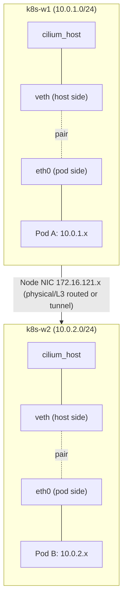
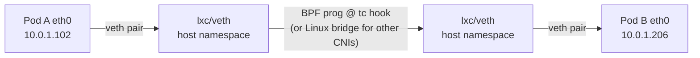
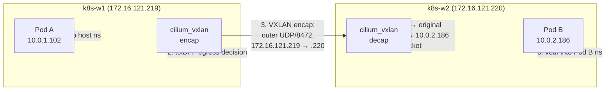

## 🕸️ Demystifying the Kubernetes Network Stack (Pod to Pod)
## Table of Contents

- [Overview](#overview)
- [Why This Matters (Motivation)](#why-this-matters-motivation)
- [Lab Environment](#lab-environment)
- [The Four Networking Problems Kubernetes Solves](#the-four-networking-problems-kubernetes-solves)
- [Architecture Diagram](#architecture-diagram)
- [Layer 1: Container-to-Container (Inside a Pod)](#layer-1-container-to-container-inside-a-pod)
- [Layer 2: Pod-to-Pod, Same Node](#layer-2-pod-to-pod-same-node)
- [Layer 3: Pod-to-Pod, Across Nodes](#layer-3-pod-to-pod-across-nodes)
- [iptables vs eBPF: Why Cilium Skips kube-proxy](#iptables-vs-ebpf-why-cilium-skips-kube-proxy)
- [Hands-On Demo: Tracing a Packet Across Nodes](#hands-on-demo-tracing-a-packet-across-nodes)
- [Troubleshooting](#troubleshooting)
- [Key Takeaways](#key-takeaways)

## 🧭 Overview

This article is my write-up after watching [**"Demystifying the Kubernetes Network Stack (From Pod to Pod)" by Simone Rodigari (Microsoft)**](https://www.youtube.com/watch?v=fj5UQ0WBmAg), presented at KubeCon + CloudNativeCon. I wanted to take the concepts from that talk and actually reproduce them on my own 3-node home lab, so this isn't just theory — every layer below is something I traced and verified myself.

It includes:
+ ✅ The 3 (well, 4) networking problems Kubernetes must solve
+ ✅ What actually happens at each hop: container → pod → node → node
+ ✅ Network namespaces, veth pairs, and why they exist
+ ✅ How Cilium's eBPF datapath replaces iptables/kube-proxy
+ ✅ A hands-on demo tracing a real packet cross-node

> _Note: My lab uses Cilium as CNI (see [Create local Kubernetes cluster](https://github.com/faizyakob/my-k8s-repository/blob/main/docs/Create%20local%20Kubernetes%20cluster.md)). Some of what's below (kube-proxy replacement, BPF datapath) is Cilium-specific — if you're running Flannel or Calico in overlay mode, the cross-node hop will look different (VXLAN encapsulation via `flannel.1` or similar instead of native eBPF routing). I'll call out where that matters._
>
> _While writing this I also found a real misconfiguration on my own cluster — `kube-proxy-replacement=true` is set, but the `kube-proxy` DaemonSet was never removed, so both it and Cilium's eBPF datapath are active at once. See the [iptables vs eBPF](#iptables-vs-ebpf-why-cilium-skips-kube-proxy) section — I kept it in as a real-world gotcha instead of editing it out._

## 📜 Why This Matters (Motivation)

Most of us treat pod-to-pod networking as a black box — you write a Service, pods magically talk to each other, done. But when things break (a `CrashLoopBackOff` that's actually a DNS timeout, a `NetworkPolicy` silently dropping traffic, cross-node latency that shouldn't exist), you need a mental model of what's *actually* moving packets under the hood.

This ties directly into two things I care about:
+ 🔧 On the Nexus side, starting from NC 4.13 Cilium will gradually replace Calico as the CNI.
+ 📚 On the homelab side, this is the natural follow-up to my [`du` vs `df`](https://github.com/faizyakob/my-linux-repo/blob/main/du-vd-df.md) and [SELinux](https://github.com/faizyakob/my-linux-repo/blob/main/SELINUX.md) articles — same "don't trust the abstraction, go look at the kernel" approach, applied to networking.

## 🖥️ Lab Environment

| Component | Detail |
|---|---|
| Host | MacBook Air M3, VMware Fusion Pro |
| Nodes | 3x RHEL VM (1 control-plane, 2 workers) |
| CNI | Cilium (eBPF, `kubeProxyReplacement=true`) |
| Pod CIDR | `10.0.0.0/16`, per-node `/24`: `k8s-cp`=`10.0.0.0/24`, `k8s-w1`=`10.0.1.0/24`, `k8s-w2`=`10.0.2.0/24` |
| Node CIDR | `172.16.121.0/24` |

## 🧩 The Four Networking Problems Kubernetes Solves

Kubernetes' networking model is built on a deceptively simple set of rules — the hard part is what it takes underneath to satisfy them:

1. **Container-to-container** — containers in the same pod communicate over `localhost`.
2. **Pod-to-pod, same node** — pods on the same node reach each other directly, without NAT.
3. **Pod-to-pod, across nodes** — pods on different nodes reach each other directly, without NAT, using the *same* IP the pod sees itself as.
4. **Pod-to-Service (and external)** — traffic to a stable virtual IP gets load-balanced to the right backend pod. *(This one deserves its own article — I'm scoping this write-up to pod-to-pod only.)*

Rules 1–3 are what the talk (and this article) focuses on.

## 🏗️ Architecture Diagram



## 📦 Layer 1: Container-to-Container (Inside a Pod)

All containers in a pod share the **same network namespace**. This is set up by the *pause* container (also called the "infra container") — it's the first container kubelet creates for any pod, and it does nothing except hold the network namespace open.

```
crictl pods --name <pod-name>
crictl inspectp <pod-id> | grep -A3 network
```

Because containers share a namespace, they share the same loopback interface. A container listening on `localhost:8080` is reachable from every other container in that pod on `localhost:8080` — no ports, no NAT, just shared kernel networking state.

> 💡 This is why sidecar patterns (Envoy, log shippers) work the way they do — the sidecar and the app container aren't really "networked together", they're in the *same* network namespace to begin with.

## 🔗 Layer 2: Pod-to-Pod, Same Node

Each pod gets its own network namespace, connected to the node's root namespace via a **veth (virtual ethernet) pair** — think of it as a virtual patch cable with two ends:
+ One end lives inside the pod's namespace, appears as `eth0`.
+ The other end lives in the node's root namespace, appears as something like `lxcXXXXXX` (Cilium) or `vethXXXXXX` (bridge-based CNIs).

```
# From the node, list veth interfaces belonging to pods
ip link show type veth

# Map a specific pod to its host-side veth
kubectl get pod <pod-name> -o jsonpath='{.status.podIP}'
kubectl -n kube-system exec -it cilium-zm7ts -- cilium-dbg endpoint list   # shows pod IP <-> lxc interface <-> veth mapping
```

Real output from `k8s-cp`:

```
$ ip link show type veth
4: cilium_net@cilium_host: <BROADCAST,MULTICAST,NOARP,UP,LOWER_UP> mtu 1500 qdisc noqueue state UP mode DEFAULT group default qlen 1000
    link/ether 52:c3:04:1a:6c:4c brd ff:ff:ff:ff:ff:ff
5: cilium_host@cilium_net: <BROADCAST,MULTICAST,NOARP,UP,LOWER_UP> mtu 1500 qdisc noqueue state UP mode DEFAULT group default qlen 1000
    link/ether ea:2c:93:1f:9f:d2 brd ff:ff:ff:ff:ff:ff
7: lxcaaa985977e67@if6: <BROADCAST,MULTICAST,UP,LOWER_UP> mtu 1500 qdisc noqueue state UP mode DEFAULT group default qlen 1000
    link/ether 0a:80:d3:e8:1c:9a brd ff:ff:ff:ff:ff:ff link-netns cni-59658ad9-7a53-ac6d-7cd0-fa44c8844f36
10: lxc_health@if9: <BROADCAST,MULTICAST,UP,LOWER_UP> mtu 1500 qdisc noqueue state UP mode DEFAULT group default qlen 1000
    link/ether 5a:ec:a9:d2:c9:8e brd ff:ff:ff:ff:ff:ff link-netnsid 1
```

Four interfaces, three different roles worth telling apart:
+ **`cilium_net@cilium_host`** — this is *not* a pod veth. It's Cilium's own internal veth pair on every node, used to route traffic between the host namespace and Cilium's own datapath (things like health checks, host-level policy). You'll see this pair on every node regardless of how many pods are scheduled there.
+ **`lxcaaa985977e67@if6`** — *this* is an actual pod's host-side veth. The `link-netns cni-59658ad9-...` tells you exactly which pod network namespace it's paired with — that's the `if6` on the other end, inside the pod, appearing as `eth0`. This corresponds to the `static-web-k8s-cp` pod scheduled on this node.
+ **`lxc_health@if9`** — Cilium's dedicated health-check endpoint (the `reserved:health` identity from the `cilium-dbg endpoint list` output above) — a synthetic endpoint Cilium uses to probe node reachability, not an application pod.

> 💡 The `link-netns` field is the fastest way to tie a host-side `lxcXXXXXX` interface back to a specific pod without going through `cilium-dbg` at all — cross-reference it against `crictl inspectp <pod-id> | grep netns` or `ip netns list` on the node.

> 💡 **Two different tools, easy to mix up**: `cilium` (run directly on a node — e.g. `cilium status`, `cilium config view`) is the **Cilium CLI**, a client tool. `cilium-dbg` is the **agent's internal debug tool** — it only exists *inside* the `cilium-*` agent pods, so it always needs `kubectl -n kube-system exec -it <cilium-pod> --`. It's also node-scoped: `endpoint list` only shows endpoints local to whichever node's Cilium pod you exec into. My three agent pods: `cilium-zm7ts` (k8s-cp), `cilium-fd87p` (k8s-w1), `cilium-xvxcb` (k8s-w2).

Here's what that actually looks like, run against `cilium-zm7ts` on my control-plane node:

```
$ kubectl -n kube-system exec -it cilium-zm7ts -- cilium-dbg endpoint list
ENDPOINT   POLICY (ingress)   POLICY (egress)   IDENTITY   LABELS (source:key[=value])                          IPv6   IPv4        STATUS
           ENFORCEMENT        ENFORCEMENT
514        Disabled           Disabled          4          reserved:health                                             10.0.0.83   ready
1008       Enabled            Enabled           5          reserved:init                                               10.0.0.38   ready
1756       Disabled           Disabled          1          k8s:node-role.kubernetes.io/control-plane
                                                            k8s:node.kubernetes.io/exclude-from-external-load-balancers
                                                            reserved:host                                                           ready
```

Only 3 endpoints — no application pods, just Cilium's own internal identities (`health`, `init`, `host`). That makes sense: control-plane nodes don't usually run much workload. When you run this same command against `cilium-fd87p` or `cilium-xvxcb` (the workers), you'll see real application pod endpoints with their own IPs and identities instead.

On the node, these veth "host ends" attach into the CNI's datapath. With bridge-based CNIs (Flannel, older Calico modes) that datapath is a Linux bridge (`cbr0`/`cni0`) doing L2 forwarding. With Cilium, there's no bridge at all — each veth is individually attached to the eBPF datapath, and routing/forwarding decisions happen in BPF programs attached to the veth's `tc` (traffic control) hooks, not via a bridge or iptables.



## 🌐 Layer 3: Pod-to-Pod, Across Nodes

This is where the CNI plugin earns its keep. The node's root namespace routes the packet out its physical NIC toward the destination node. How it gets there depends on the CNI's routing mode:

| Mode | How it works | Example CNI |
|---|---|---|
| **Overlay (encapsulation)** ✅ *(this lab)* | Packet wrapped in VXLAN/Geneve, sent as a regular UDP packet between node IPs, unwrapped on arrival | Flannel (VXLAN), Cilium (VXLAN mode) |
| **Native routing (no overlay)** | Node routing tables / BGP peer with each other so pod CIDRs are directly routable, no encapsulation | Calico (BGP), Cilium (native routing mode) |

My lab runs Cilium in **VXLAN overlay mode**, confirmed via:

```
$ cilium config view | grep -Ei 'routing|tunnel|ipsec|encryption'
direct-routing-skip-unreachable                   false
routing-mode                                      tunnel
tunnel-protocol                                   vxlan
tunnel-source-port-range                          0-0
```

`routing-mode: tunnel` + `tunnel-protocol: vxlan` means every pod-to-pod packet crossing nodes gets wrapped in a VXLAN header and sent as regular UDP (destination port 8472) between the two nodes' `172.16.121.0/24` IPs, then unwrapped on arrival. The underlying physical/node network never needs to know about pod IPs at all — it just sees UDP traffic between node IPs. That's the whole point of an overlay: it decouples the pod network from whatever routing the physical network happens to support.



Whatever the mode, the Kubernetes contract holds: Pod A's packet leaves with source IP `10.0.1.102` and destination `10.0.2.186`, and it arrives at Pod B with those exact IPs — **no NAT anywhere in this path**. VXLAN only adds and removes an *outer* header; the inner packet (the one your applications actually see) is untouched end to end.

## ⚡ iptables vs eBPF: Why Cilium Skips kube-proxy (and a Real Gotcha I Found on My Own Cluster)

Traditionally, `kube-proxy` programs iptables (or IPVS) rules on every node to handle Service VIP → pod IP translation. That's a *separate* concern from pod-to-pod routing, but it's worth understanding since it's the classic "networking demystified" comparison point:

| | iptables (kube-proxy default) | eBPF (Cilium `kubeProxyReplacement`) |
|---|---|---|
| Rule evaluation | Sequential chain walk, O(n) with number of Services | Hash table lookup, O(1) |
| Where it runs | Netfilter hooks in the kernel | BPF programs at `tc`/XDP hooks, even earlier in the packet path |
| Scales with large clusters | Degrades — long iptables chains | Stays flat |
| Visibility | `iptables -L`, hard to correlate to pods | `cilium-dbg service list`, `cilium-dbg monitor` (both via `kubectl exec` into the agent pod), maps pod identity directly |

The idea is: when `kubeProxyReplacement=true`, Cilium's eBPF datapath fully takes over Service routing and you're expected to delete the `kube-proxy` DaemonSet — running both is redundant at best.

> ⚠️ **What I actually found on my cluster**: `cilium config view` shows `kube-proxy-replacement=true`, but `kube-proxy` is still deployed and its logs confirm it's actively running `"Using iptables Proxier"`, syncing service and endpoint-slice configs. So right now, both are live at once:
> ```
> $ cilium config view | grep -i kube-proxy-replacement
> kube-proxy-replacement                            true
>
> $ kubectl -n kube-system logs kube-proxy-9nddd | tail -5
> I... "Using iptables Proxier"
> I... "Starting service config controller"
> ```
> This is a leftover from cluster setup — the DaemonSet was never removed after enabling replacement. It's not necessarily *breaking* anything today (Cilium's eBPF path likely wins for pod-to-pod traffic since it acts earlier at the `tc` hook), but it's wasted cycles and a real footgun: two independent systems both believe they own Service routing, and if they ever disagree, it'll be a nightmare to debug. Cleanup is `kubectl -n kube-system delete ds kube-proxy` plus flushing the leftover iptables chains — on my list.

```
# Check what kube-proxy is doing (iptables side)
iptables -t nat -L KUBE-SERVICES -n | head

# Check what Cilium is doing (eBPF side) — should show the same Services
kubectl -n kube-system exec -it cilium-zm7ts -- cilium-dbg service list
kubectl -n kube-system exec -it cilium-zm7ts -- cilium-dbg bpf lb list
```

If you see the same Services populated on *both* sides, that's the coexistence bug confirmed — exactly what happened here.

## 🧪 Hands-On Demo: Tracing a Packet Across Nodes

This is the reproduction of the talk's demo, adapted for my 3-node cluster.

### Step 1: Deploy two pods pinned to different workers

```
apiVersion: v1
kind: Pod
metadata:
  name: net-pod-a
spec:
  nodeName: worker-1
  containers:
  - name: tools
    image: nicolaka/netshoot
    command: ["sleep", "infinity"]
---
apiVersion: v1
kind: Pod
metadata:
  name: net-pod-b
spec:
  nodeName: worker-2
  containers:
  - name: tools
    image: nicolaka/netshoot
    command: ["sleep", "infinity"]
```

```
kubectl apply -f net-pods.yaml
kubectl get pods -o wide
```

### Step 2: Confirm pod IPs and node placement

```
kubectl get pod net-pod-a -o jsonpath='{.status.podIP} {.spec.nodeName}{"\n"}'
kubectl get pod net-pod-b -o jsonpath='{.status.podIP} {.spec.nodeName}{"\n"}'
```

### Step 3: Identify the host-side veth for `net-pod-a`

```
kubectl -n kube-system exec -it cilium-fd87p -- cilium-dbg endpoint list | grep net-pod-a
```

Expected: an endpoint row showing the pod's IP mapped to an `lxcXXXXXX` interface — that's your host-side veth.

### Step 4: Watch the packet leave the node

Run on **worker-1**, while curling from `net-pod-a` to `net-pod-b`'s IP:

```
# Terminal 1 — capture on the pod's veth
tcpdump -i lxcXXXXXX -n icmp

# Terminal 2 — generate traffic
kubectl exec net-pod-a -- ping -c 3 <net-pod-b-IP>
```

You should see ICMP echo requests leaving with the pod's *real* IP as source — confirming no NAT happened at this hop.

### Step 5: Watch it arrive on the other node

Run on **worker-2**:

```
tcpdump -i any udp port 8472 -n -vv
```

Since this cluster runs Cilium in VXLAN mode, you won't see a plain ICMP packet arrive directly — you'll see it arrive **encapsulated** as a UDP/8472 VXLAN packet between the two node IPs (`172.16.121.219` → `172.16.121.220`). Cilium's datapath decapsulates it internally (in eBPF, not via a visible userspace step) before delivering the original ICMP packet into Pod B's namespace. If you want to see the original inner packet too:

```
tcpdump -i lxcXXXXXX -n icmp   # on the pod B host-side veth
```

That should show the same ICMP echo request/reply you sent from Pod A — proving the outer VXLAN header was stripped and the original pod-to-pod packet delivered untouched.

### Step 6: Cross-check with Cilium's own tracing

```
kubectl -n kube-system exec -it cilium-fd87p -- cilium-dbg monitor --type drop   # run on the node you expect the drop on
kubectl -n kube-system exec -it cilium-zm7ts -- cilium-dbg bpf tunnel list   # shows the VXLAN tunnel endpoint map: node IP <-> node IP
```

`cilium-dbg monitor --type drop` is the single most useful command when pod-to-pod traffic *doesn't* arrive — it tells you exactly which BPF program dropped the packet and why (e.g. a `NetworkPolicy` denial vs. a routing failure). Remember it's node-scoped, so exec into the Cilium pod on the node where you expect the drop.

## 🛠️ Troubleshooting

+ ❌ Pod can't reach pod on same node → check `kubectl -n kube-system exec -it <cilium-pod-on-that-node> -- cilium-dbg endpoint list` for endpoint state `not-ready`, check `tc filter show dev lxcXXXXXX`
+ ❌ Pod can't reach pod cross-node → check `cilium status` for tunnel/routing mode mismatch between nodes, check node-to-node connectivity on the physical NIC first
+ ❌ Traffic silently dropped → `kubectl -n kube-system exec -it <cilium-pod> -- cilium-dbg monitor --type drop` before anything else
+ ❌ Works with `ping` but not `curl` → likely a `NetworkPolicy` scoped to TCP, or DNS resolution failing separately (see my upcoming DNS resolution chain article)
+ ❌ Service routing behaves inconsistently / hard to reason about → check `cilium config view | grep kube-proxy-replacement` **and** `kubectl -n kube-system get ds kube-proxy` — if replacement is `true` but the DaemonSet still exists, you have two systems fighting over the same job (see above)

## 🎯 Key Takeaways

+ Container-to-container is "free" — it's just a shared network namespace, no networking happens at all.
+ Pod-to-pod, same node, is a veth pair plus whatever forwarding logic the CNI attaches (bridge, or in Cilium's case, BPF at the `tc` hook).
+ Pod-to-pod, cross-node, depends entirely on the CNI's routing mode — overlay (VXLAN/Geneve) vs native routing — but the Kubernetes contract of "no NAT, same IP everywhere" holds regardless.
+ eBPF-based dataplanes (Cilium) replace iptables' sequential chain walk with O(1) hash lookups, which is why it scales better on large clusters — this is orthogonal to pod-to-pod routing but shows up in the same debugging toolkit.
+ `cilium-dbg monitor --type drop` and `cilium-dbg endpoint list` (both via `kubectl exec` into the relevant Cilium agent pod) are the two commands I'll reach for first from now on when triaging Cilium networking cases at work, not just in the lab.
+ **`kube-proxy-replacement=true` in config doesn't mean kube-proxy is actually gone** — always verify the DaemonSet was removed, don't just trust the config flag. Found this the hard way on my own cluster while writing this article.

Next up on my list: the DNS resolution chain (`getaddrinfo` → `nsswitch.conf` → `systemd-resolved`) and how that interacts with this same pod network path — that's the natural continuation of this article.
